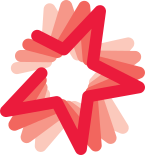

<p align="center">
  
</p>

<h1 align="center">7rrek</h1>

<p align="center">
  <b>Free, open-source animation — part of the Creative Studio creative suite.</b><br>
  <b>رسوم متحركة، مجاني ومفتوح المصدر — جزء من حزمة Creative Studio.</b>
</p>

<p align="center">
  <a href="https://7rrek.studio.creative.ps/">7rrek.studio.creative.ps</a> ·
  <a href="https://studio.creative.ps/">studio.creative.ps</a>
</p>

<p align="center">
  
  
</p>

## Built on VectorCraft

7rrek is a fork of **[VectorCraft](https://github.com/storytold/vectorcraft)**, the open-source, clean-room
application written in Rust by the **[ArtCraft](https://getartcraft.com/)** team and the VectorCraft
contributors. Almost everything that makes this app work is their work. Thank you. If you like
7rrek, please star and support the upstream project as well.

What we add: the Creative Studio identity, the Arabic interface laid out right to left, and Arabic
features to come. Our changes are listed in [`studio/CHANGES.md`](studio/CHANGES.md).
Upstream's own README, with the full feature list and build instructions, is in
[`docs/UPSTREAM-README.md`](docs/UPSTREAM-README.md).

## The Creative Studio suite

Fifteen free, open-source apps with an Arabic interface laid out right to left. [mansa (المنصّة)](https://github.com/7mz410/CreativeStudio-mansa) installs and updates them all. The whole suite: [github.com/7mz410/CreativeStudio](https://github.com/7mz410/CreativeStudio) · [studio.creative.ps](https://studio.creative.ps/).

| App | | What it's for | Saves as | Based on |
|---|---|---|---|---|
| [rsm](https://github.com/7mz410/CreativeStudio-rsm) | رسم | Vector illustration | `.rsm` | VectorCraft |
| **7rrek** | حرّك | Animation | `.7rrek` | VectorCraft (via rsm) |
| [tlween](https://github.com/7mz410/CreativeStudio-tlween) | تلوين | Image editing | `.tlween` | PhotoCraft |
| [lamasat](https://github.com/7mz410/CreativeStudio-lamasat) | لمسات | Photo library and raw development | — | LightCraft |
| [tsweer](https://github.com/7mz410/CreativeStudio-tsweer) | تصوير | Video editing | `.tsweer` | FilmCraft |
| [effectat](https://github.com/7mz410/CreativeStudio-effectat) | تأثيرات | Motion graphics and effects | `.effectat` | EffectCraft |
| [aswat](https://github.com/7mz410/CreativeStudio-aswat) | أصوات | Audio recording and mixing | `.aswat` | SoundCraft |
| [al7an](https://github.com/7mz410/CreativeStudio-al7an) | ألحان | Music making | `.al7an` | SoundCraft |
| [trteeb](https://github.com/7mz410/CreativeStudio-trteeb) | ترتيب | Page layout | `.trteeb` | DesignCraft |
| [sharek](https://github.com/7mz410/CreativeStudio-sharek) | شارك | Interface and graphic design | `.sharek` | FigCraft |
| [sf7aat](https://github.com/7mz410/CreativeStudio-sf7aat) | صفحات | PDF documents | `.pdf` | PdfCraft |
| [klmat](https://github.com/7mz410/CreativeStudio-klmat) | كلمات | Word processing | `.docx` | WordCraft |
| [arqam](https://github.com/7mz410/CreativeStudio-arqam) | أرقام | Spreadsheets | `.xlsx` | GridCraft |
| [3urood](https://github.com/7mz410/CreativeStudio-3urood) | عروض | Presentations | `.3urood` | DeckCraft |
| [muhandes](https://github.com/7mz410/CreativeStudio-muhandes) | مهندس | Computer-aided design | `.dxf` | CADCraft |

## Building

For posters and sewing patterns, see [Print a large poster across multiple pages](docs/print-tiling.md).

```sh
cargo run --release -p vectorcraft
# after merging upstream:
git fetch upstream && git merge upstream/main && python3 studio/rebrand.py
```

## Licence

On machines with two graphics processors, VectorCraft renders on the power-saving (integrated) one by default on
Windows and macOS, and on the one the desktop runs on under Linux. To choose, use **Preferences › Performance ›
Graphics Processor** and restart. If a graphics processor can't show the window, VectorCraft starts again on the
next one. To pick one when starting the app, set `WGPU_POWER_PREF=high` (or `low`), or `WGPU_ADAPTER_NAME` to part of
its name, such as `WGPU_ADAPTER_NAME=nvidia` (see [`docs/development.md`](docs/development.md#desktop-graphics-processor)).

On native Wayland, winit 0.30 does not deliver dropped files. To open an SVG, use File › Open;
to place artwork in the current document, copy and paste the file in a file manager. For file
drag-and-drop, set **Preferences › Performance › Linux Display Server** to **X11 (XWayland)** and restart, or start
the app with `WAYLAND_DISPLAY= vectorcraft`: the window then opens through XWayland, where drops work
(see [`docs/development.md`](docs/development.md#linux-wayland-and-x11)).

On Linux with Wayland, under KDE Plasma 6.3 or later and under GNOME, VectorCraft doesn't respond to a drawing tablet's
pen yet (#491, #2028). Open the window through XWayland instead, where the pen works as a mouse: set the same
preference to **X11 (XWayland)**, or to **X11 (XWayland) When a Pen Is Attached** to use XWayland only when a pen is
attached as VectorCraft starts, and restart; or start the app with `WAYLAND_DISPLAY= vectorcraft` (see
[`docs/development.md`](docs/development.md#linux-wayland-and-x11)).

### Use it from Claude Code and other agents

Register the MCP server with Claude Code:

```sh
claude mcp add vectorcraft -- /path/to/vectorcraft-cli mcp
```

To keep an agent to one project's files, give it folders to read and write (the same flags as PhotoCraft):

```sh
claude mcp add vectorcraft -- /path/to/vectorcraft-cli mcp --automation-read-root /work/project --automation-write-root /work/project
```

The details are in [`docs/mcp.md`](docs/mcp.md) and [`docs/control-protocol.md`](docs/control-protocol.md).

For the experimental, unsupported 64-bit Windows 7 build, see [Windows 7 instructions](docs/windows7.md).

## Status

VectorCraft is under active development. [**ROADMAP.md**](ROADMAP.md) has the stage, the numbers by dimension
and what's next; [`docs/target-app-parity.md`](docs/target-app-parity.md) the full parity assessment and
[`docs/gaps.md`](docs/gaps.md) the ranked list of what's missing.

**Where we are (2026-10-10): alpha.** About 88% of Illustrator 2026's menu items, tools, effects and formats exist
(92.5% of menu items do something), feature depth is ~75%, and we estimate ~65% "ready for real work" for a mainstream illustrator (~62% against
all of Illustrator): everyday
vector illustration is close to usable: drawing and path tools,
Pathfinder and Shape Builder, paint, gradients, appearance and transparency, type with styles, threading and Hebrew/Arabic bidirectional layout, and
files (SVG, PDF and PDF-compatible `.ai` with PDF/X, legacy version 7 `.ai` keeping layers, groups and type, EPS, DXF, EMF/WMF, raster formats, PSD out and PSD/PSB in as their merged image, Print, Package).
Affinity documents (`.af` from Affinity 3, `.afdesign`, `.afpub` and, by their content, `.afphoto` from Affinity 1 and 2) open
and place natively: layers, groups, artboards and pages, curves and shapes, fills, gradients and strokes, clipping
and masks, text and images, with what didn't come in (effects, adjustments, brushes, master pages…) listed in the
import warning; a file whose native data can't be read opens as its embedded preview, saying why. VectorCraft
doesn't write Affinity files. Current `.af` validation includes 33 pinned files, native save/reload
and every-board SVG/PDF/PSD export, with fixes for Affinity 3 artboards, source-backed JPEGs and text runs.
[Scope and limits](crates/affinity/README.md); [source audit and remaining gaps](docs/affinity-validation.md).
The interface
speaks English, German, Japanese, Korean, Vietnamese, Traditional and Simplified Chinese, Spanish, French, Hungarian, Italian, Polish, Brazilian Portuguese, Russian, Swedish, Ukrainian, Finnish, Bulgarian, Greek and Czech;
[localization-parity.md](docs/localization-parity.md) has the details.
The scores are self-assessed from our code against Illustrator's public documentation;
[target-app-parity.md](docs/target-app-parity.md#how-this-was-measured-2026-10-10) explains how far to trust them.

**What's missing:**
- reliable exchange of Illustrator's own `.ai` files (layer structure in real files; Illustrator's editing data isn't written);
- an interaction-fidelity pass covering every tool's modifiers and small behaviours;
- 3D and Materials beyond the initial live Revolve (Extrude & Bevel, Inflate, Rotate, materials);
- most of the raster effects (9 of 57 still missing; Cutout, Film Grain, Neon Glow, Plastic Wrap, Poster Edges, Smudge Stick, Sponge and Watercolor are available under Artistic, Bas Relief, Chalk & Charcoal, Charcoal, Chrome, Graphic Pen, Halftone Pattern, Note Paper, Photocopy, Plaster, Reticulation, Stamp, Torn Edges and Water Paper under Sketch) and the Effect Gallery;
- CJK composition for vertical type (vertical type itself has initial support, with a Japanese interface);
- scripting, and the rest of Variables (image and graph kinds, dataset import);
- generative AI features.

**Where we're going:** next is the interaction-fidelity pass, `.ai` files from real users and start-up stability,
alongside the raster-effects package; then type, the Illustrator 2026 additions and 3D. The ranked list is in
[`docs/gaps.md`](docs/gaps.md).

**Workspace:** `crates/{geom, color, doc, pathops, text, effects, three-d, trace, brush, render, svg, pdf, eps, cad, metafile, format, tools, engine, ui-egui, mcp, testkit}`
and `apps/{vectorcraft, vectorcraft-cli, vectorcraft-web}`. The egui frontend is its own crate, so
the UI can be swapped without touching the engine.

Agent and contributor rules (clean-room, the asset policy, no panics in shipped code, quality gates) are in
[`AGENTS.md`](AGENTS.md); [`docs/development.md`](docs/development.md#robustness-vectorcraft-never-crashes)
explains how VectorCraft avoids crashing, and [`docs/releasing.md`](docs/releasing.md) how releases are built,
signed and published. Every bundled asset is listed with its licence in [`ASSETS.md`](ASSETS.md).

## Downloads

**New to VectorCraft?** Download it from the [VectorCraft page on getartcraft.com](https://getartcraft.com/apps/vectorcraft). That's the easiest way to install it.

**Want a specific build or format?** On GitHub, the [latest release](https://github.com/storytold/vectorcraft/releases/latest) has every build listed below, and [all releases](https://github.com/storytold/vectorcraft/releases) has earlier versions and their notes. `<ver>` in the file names is the version number, and `SHA256SUMS.txt` lists a checksum for every file.

### Windows

| Build | Installer | Portable |
|---|---|---|
| x64 (64-bit Intel/AMD) | `vectorcraft-<ver>-windows-x64.msi` | `vectorcraft-<ver>-windows-x64-portable.zip` |
| arm64 (Snapdragon and other ARM PCs) | `vectorcraft-<ver>-windows-arm64.msi` | `vectorcraft-<ver>-windows-arm64-portable.zip` |
| x86 (32-bit) | `vectorcraft-<ver>-windows-x86.msi` | `vectorcraft-<ver>-windows-x86-portable.zip` |

Installers and executables are code-signed.

### macOS

| Build | File | Notes |
|---|---|---|
| App, universal (Apple silicon + Intel) | `vectorcraft-<ver>-macos-universal.dmg` | Signed and notarized |
| Command-line tool, universal | `vectorcraft-cli-<ver>-macos-universal.zip` | Signed and notarized |

### Linux

| Format | x86_64 | aarch64 (ARM64) | Notes |
|---|---|---|---|
| AppImage | `vectorcraft-<ver>-linux-x86_64.AppImage` | `vectorcraft-<ver>-linux-aarch64.AppImage` | Runs anywhere; updates itself with [AppImageUpdate](https://github.com/AppImageCommunity/AppImageUpdate) (`.zsync` files) |
| Flatpak | `vectorcraft-<ver>-linux-x86_64.flatpak` | `vectorcraft-<ver>-linux-aarch64.flatpak` | Sandboxed; `flatpak install --user <file>` |
| Debian/Ubuntu | `vectorcraft-<ver>-linux-x86_64.deb` | `vectorcraft-<ver>-linux-aarch64.deb` | |
| Fedora/RHEL/openSUSE | `vectorcraft-<ver>-linux-x86_64.rpm` | `vectorcraft-<ver>-linux-aarch64.rpm` | |
| Tarball | `vectorcraft-<ver>-linux-x86_64.tar.gz` | `vectorcraft-<ver>-linux-aarch64.tar.gz` | Unpack anywhere |

### FreeBSD

| Build | File |
|---|---|
| x86_64 | `vectorcraft-<ver>-freebsd-x86_64.tar.gz` |

### Web (WebAssembly)

| Build | File | Notes |
|---|---|---|
| Static site | `vectorcraft-web-<ver>.zip` | Runs in a modern browser; host it on any static server |

## The Crafting Apps

VectorCraft is one of the **Crafting Apps**: free, open-source creative tools from the
[ArtCraft](https://getartcraft.com/) team, each written from scratch in Rust and each able to
stand on its own.

| | App | What it's for | Code | Learn more |
|:-:|---|---|---|---|
|  | **PhotoCraft** | Image editing: layers, masks, type and real PSD files | [GitHub](https://github.com/storytold/photocraft) | [Website](https://getartcraft.com/apps/photocraft) |
|  | **VectorCraft** | **Vector illustration · you are here** | [GitHub](https://github.com/storytold/vectorcraft) | [Website](https://getartcraft.com/apps/vectorcraft) |
|  | **FilmCraft** | Video editing, color and sound | [GitHub](https://github.com/storytold/filmcraft) | [Website](https://getartcraft.com/apps/filmcraft) |
|  | **LightCraft** | Photo library and raw development | [GitHub](https://github.com/storytold/lightcraft) | [Website](https://getartcraft.com/apps/lightcraft) |
|  | **PdfCraft** | Reading, organizing and protecting PDFs | [GitHub](https://github.com/storytold/pdfcraft) | [Website](https://getartcraft.com/apps/pdfcraft) |
|  | **EffectCraft** | Motion graphics and visual effects | [GitHub](https://github.com/storytold/effectcraft) | [Website](https://getartcraft.com/apps/effectcraft) |
|  | **DesignCraft** | Page layout and publishing | [GitHub](https://github.com/storytold/designcraft) | [Website](https://getartcraft.com/apps/designcraft) |

And [**ArtCraft**](https://getartcraft.com/) itself, our AI image and video studio for artists who want real control.

<br>

<p align="center">
  <a href="https://discord.gg/artcraft"></a>
</p>

<h3 align="center">Come make things with us</h3>

<p align="center">
  Our Discord is where artists of every kind hang out: people who paint, shoot, draw, cut film,
  set type, and people still figuring out what they like to make. Share what you're working on,
  ask for help, tell us what's broken, or tell us what you wish these tools could do.
  Whatever your medium and however long you've been at it, you're welcome here.
</p>

<p align="center">
  <a href="https://discord.gg/artcraft"><b>discord.gg/artcraft</b></a> ·
  <a href="https://getartcraft.com/">getartcraft.com</a> ·
  <a href="https://getartcraft.com/apps">The Crafting Apps</a> ·
  <a href="https://getartcraft.com/apps/vectorcraft">VectorCraft</a>
</p>

## Star history

[](https://www.star-history.com/?repos=storytold%2Fvectorcraft&type=date&legend=top-left)

## License and credits

VectorCraft is dual-licensed under [MIT](LICENSE-MIT) or [Apache-2.0](LICENSE-APACHE), at your option.
Copyright (c) 2026 ArtCraft Team and the VectorCraft contributors. Required notices are in [NOTICE](NOTICE).

Bundled fonts, icons, images and other assets keep their own open licenses; each one is listed
with its author, source and license in [ASSETS.md](ASSETS.md). Release builds also embed the
fonts of [craft-fonts](https://github.com/storytold/craft-fonts/blob/main/ATTRIBUTION.md) (Japanese,
Simplified Chinese and Arabic faces; SIL Open Font License 1.1).

The app icon (an engraved dragon on VectorCraft red, `#e8573f`) is the owner's original artwork; its
palette and files are in [`assets/app-icon/`](assets/app-icon/README.md).

The ArtCraft name, wordmark and logos in [`docs/brand/`](docs/brand/) are trademarks of the
ArtCraft Team and are not covered by this license. They may be used only unmodified, and only as
part of this repository and VectorCraft, under [`docs/brand/LICENSE-brand.txt`](docs/brand/LICENSE-brand.txt).
Forks and modified versions must remove them.

<sub>Adobe, Photoshop, Illustrator, Premiere Pro, Lightroom, Acrobat, After Effects and InDesign are trademarks or registered trademarks of Adobe Inc. in the United States and/or other countries. VectorCraft is an independent, open-source project and is not affiliated with, sponsored by or endorsed by Adobe Inc.; these names are used only to describe the workflows it is compatible with.</sub>

<p align="center">
  <a href="https://getartcraft.com/"></a><br>
  <sub>Made by the <a href="https://getartcraft.com/">ArtCraft</a> team and community.</sub>
</p>
